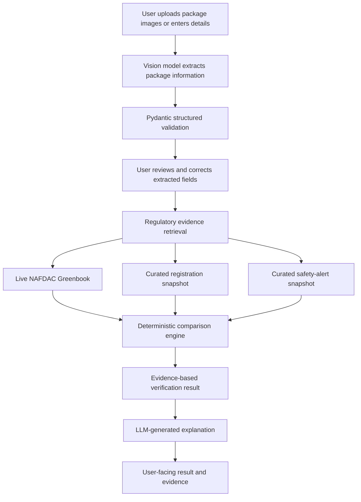

# CONFAM — AI-Assisted Medicine Package & Regulatory Evidence Checker

**NAFDAC verifies the number. CONFAM verifies the product.**

CONFAM is an independent AI-assisted platform designed to help users examine medicine-package information and compare the claims printed on medicine packaging against available regulatory registration records and safety information.

It combines vision-based information extraction, structured data validation, regulatory evidence retrieval and deterministic comparison logic to make medicine-registration information easier to understand.

> **Important:** CONFAM is an independent prototype. It is not developed, operated, endorsed or approved by NAFDAC. It does not replace official regulatory verification, laboratory testing, pharmacist judgment or other established medicine-authentication processes. A registration-record match does not prove that a physical medicine is genuine, safe or of acceptable quality.

**Live application:** https://confam-vb2a.vercel.app  

---

## 1. The Problem

A medicine package can display a genuine NAFDAC registration number that actually belongs to a different medicine.

Checking whether a registration number exists is therefore not sufficient to establish whether the product information printed on a package corresponds to the registered product.

Users may need to manually compare several details, including:

- Product name
- NAFDAC registration number
- Active ingredients and composition
- Strength
- Dosage form
- Registration-holder or applicant information

This process can be time-consuming and difficult for consumers and frontline pharmacy personnel.

CONFAM addresses this information-comparison problem by extracting medicine-package claims and comparing them with available regulatory evidence.

## 2. What CONFAM Does

- **AI-powered package extraction:** Extracts visible medicine information from uploaded package images.
- **Structured validation:** Converts extracted information into validated fields using Pydantic.
- **Human review:** Allows users to review and correct extracted information before verification.
- **Live Greenbook lookup:** Queries the publicly accessible NAFDAC Greenbook web interface for registration records.
- **Local evidence fallback:** Uses a separate curated registration snapshot when appropriate.
- **Safety-alert checking:** Searches available curated safety-alert information for relevant records.
- **Deterministic verification:** Compares package claims against retrieved regulatory evidence.
- **Evidence-grounded explanations:** Uses an LLM to explain findings without allowing it to override the verification engine.
- **Ask CONFAM:** Provides a tool-using conversational agent for questions about retrieved regulatory evidence.
- **Telegram integration:** Supports multi-image package submission through a Telegram bot connected to the same backend workflow.

## 3. How It Works



### Verification workflow

1. The user submits medicine details manually or uploads package images.
2. The vision model extracts visible package information.
3. Pydantic validates the extracted information into structured fields.
4. The user reviews and can correct the extracted claims.
5. The backend retrieves relevant registration and safety evidence.
6. The deterministic verification engine compares supported fields.
7. The system generates a result based on the available evidence.
8. The language model explains the findings in understandable language.

The language model assists with extraction and explanation. It does not independently determine whether a medicine is genuine or counterfeit.

## 4. Technology Stack

| Component | Technology |
|---|---|
| Frontend | React, TypeScript, Vite |
| Backend | Python, FastAPI |
| Data validation | Pydantic |
| Vision extraction | Groq-hosted Qwen3.8-27B |
| Language generation | Groq-hosted GPT-OSS-120B |
| Agent tool calling | Groq tool-calling capabilities |
| Agent interoperability | Model Context Protocol (MCP) |
| Product-name matching | RapidFuzz |
| Local persistence | SQLite |
| Frontend deployment | Vercel |
| Backend deployment | Render |
| Messaging integration | Telegram Bot API |

### Why separate the AI and verification layers?

Generative AI models can produce plausible but incorrect information. For a medicine-evidence application, allowing an LLM to make the final verification decision would introduce unnecessary risk.

CONFAM separates these responsibilities:

- The vision model extracts claims from images.
- Pydantic validates the structure of the extracted information.
- Regulatory retrieval obtains external evidence.
- Deterministic backend logic performs comparisons.
- The language model explains the results.

This architecture keeps the verification decision grounded in retrieved evidence and application logic rather than unrestricted model-generated conclusions.

## 5. AI Implementation

### Vision-based extraction — Qwen3.8-27B

CONFAM uses the Groq-hosted Qwen3.8-27B vision model to interpret uploaded medicine-package images.

It extracts available information such as:

- Product name
- Registration number
- Active ingredients
- Strength
- Dosage form
- Batch number
- Manufacturing date
- Expiry date
- Other visible package details

The extracted information is treated as a set of claims, not verified regulatory facts.

Users can review and correct the extracted fields before submitting them for comparison.

### Evidence explanation and agent — GPT-OSS-120B

The Groq-hosted GPT-OSS-120B model powers natural-language explanations and the Ask CONFAM agent.

It helps users understand:

- Why a package claim differs from a registration record.
- What the retrieved registration information indicates.
- Which evidence supports a result.
- What the system could not establish.
- What limitations apply to a particular verification result.

The model is not permitted to override deterministic verification outcomes or invent regulatory evidence.

## 6. Regulatory Evidence Retrieval

CONFAM uses multiple evidence sources with explicit distinctions between live and curated information.

### Live NAFDAC Greenbook

CONFAM queries the publicly accessible Greenbook web interface:

https://greenbook.nafdac.gov.ng/

The integration uses the web interface's DataTables-style JSON search response to retrieve registration records.

The backend:

- Searches using registration numbers or product names.
- Normalises registration-number formatting.
- Performs exact normalised registration-number matching.
- Uses RapidFuzz to rank product-name search candidates.
- Preserves source information and retrieval timestamps.

Product-name similarity is used for candidate ranking, not as proof of identity.

**Important data-access distinction:** This integration uses the public Greenbook web interface. It should not be represented as an official NAFDAC developer API or as an approved commercial data feed. Commercial access, caching and redistribution permissions require clarification from NAFDAC.

### Curated registration snapshot

A curated local registration snapshot provides a separate evidence source when live retrieval is unavailable.

It supports controlled demonstrations and fallback workflows.

CONFAM does not present a local snapshot result as a live Greenbook confirmation.

### Safety-alert information

CONFAM also searches a curated safety-alert snapshot for relevant product, registration-number and batch information where supported.

The snapshot is dated 16 October 2026.

It is not a continuously updated live safety-alert feed. Results must be interpreted in the context of the snapshot's coverage and retrieval date.

### Source-status handling

The Greenbook lookup distinguishes between:

- `match` — an exact normalised registration-number match was found.
- `not_found` — no exact match was found in the searched source.
- `unavailable` — the external source could not be reached or processed.

An unavailable source or missing record does not automatically mean that a medicine is counterfeit.

## 7. Deterministic Verification

CONFAM compares supported fields from the submitted package information against retrieved regulatory records.

Depending on the available evidence, comparisons can include:

- Registration number
- Product name
- Active ingredients or composition
- Strength
- Dosage form
- Applicant or registration-holder information

Relevant values are normalised before comparison to reduce unnecessary discrepancies caused by formatting, punctuation or capitalisation.

### Manufacturer versus applicant

CONFAM keeps manufacturer and applicant information separate.

The applicant or registration holder is not automatically assumed to be the physical manufacturer.

If the source does not provide manufacturer information, CONFAM does not invent or infer it.

### Interpreting results

A successful registration-record match means the submitted registration number corresponds to a retrieved record. It does not establish the authenticity of the physical product.

A discrepancy indicates that submitted package claims do not agree with the available evidence and may warrant further investigation.

A missing record or unavailable source means that verification could not be completed using that source.

## 8. Ask CONFAM and MCP Integration

Ask CONFAM is an evidence-grounded conversational agent built around tool calling and the Model Context Protocol.

The agent can use tools including:

| Tool | Purpose |
|---|---|
| `search_greenbook_by_nrn` | Search the Greenbook using a registration number |
| `search_greenbook_by_product` | Search registration records by product name |
| `get_relevant_safety_alerts` | Retrieve relevant safety-alert information |

The MCP server exposes these capabilities to the agent through a structured tool interface.

The agent uses a bounded tool-calling workflow with a maximum of three rounds to limit repeated tool execution.

Rather than relying only on model knowledge, Ask CONFAM retrieves available evidence and uses it to explain the findings.

It is an evidence-explanation assistant, not an independent medicine-authentication authority.

## 9. Telegram Integration

CONFAM includes a Telegram bot that allows users to submit medicine-package images through a conversational interface.

The workflow supports:

1. Starting a verification session.
2. Sending multiple medicine-package images.
3. Collecting images in a per-user session.
4. Submitting the images to the backend extraction workflow.
5. Returning structured extraction results.

The bot uses the same FastAPI backend and verification infrastructure as the web application. It does not implement a separate verification engine.

The multi-image workflow supports up to six images, with provider-side image batching where necessary.

Telegram session images are held in memory during the workflow and are not intended to be permanent records.

## 10. Running Locally

### Prerequisites

- Python 3.11 or compatible supported Python version.
- Node.js and npm.
- Git.
- Groq API credentials for AI-powered features.

### Clone the repository

```bash
git clone https://github.com/Achese-creator/Confam.git
cd Confam
```

### Backend setup

```bash
cd backend

python -m venv .venv
```

Activate the virtual environment.

Windows PowerShell:

```powershell
.venv\Scripts\Activate.ps1
```

Install backend dependencies:

```bash
pip install -r requirements.txt
```

Configure the required environment variables using the project's environment configuration template and your own API credentials.

Start the FastAPI development server:

```bash
uvicorn app.main:app --reload
```

### Frontend setup

Open another terminal from the repository root:

```bash
cd frontend

npm install
npm run dev
```

Use the local frontend URL printed by Vite.

**Configuration note:** Environment-variable names and required values should be taken from the project's current configuration files. Never commit API keys, bot tokens or other secrets to Git.

## 11. Limitations

CONFAM is an evidence-checking prototype with important limitations.

1. **Image quality:** Extraction performance depends on image clarity, lighting, packaging design and visible text.
2. **Model errors:** Vision models can misread or omit package information.
3. **External dependency:** Live Greenbook retrieval depends on the availability and stability of an external website.
4. **Data coverage:** Curated registration and safety-alert snapshots may not contain every relevant record or the latest updates.
5. **Batch authentication:** CONFAM does not perform comprehensive batch-level authentication against a complete manufacturer or regulatory batch database.
6. **Manufacturing and expiry claims:** Extracted dates are package claims and are not independently confirmed against a complete batch registry.
7. **Physical authenticity:** A registration-record match does not prove that the physical medicine is genuine.
8. **Product safety:** CONFAM does not perform laboratory testing, assess storage conditions or establish clinical safety.
9. **Regulatory status:** The platform is independent and has not been represented as NAFDAC-approved.

## 12. Responsible AI and Safety

CONFAM is designed to communicate evidence and uncertainty rather than make unsupported claims.

Its responsible-use principles include:

- Separating AI-generated extraction from regulatory verification.
- Allowing users to review and correct extracted information.
- Using deterministic comparisons for verification decisions.
- Preserving evidence-source information and retrieval timestamps.
- Distinguishing live records from curated snapshots.
- Communicating unavailable and missing evidence explicitly.
- Avoiding unsupported claims of authenticity or safety.
- Not replacing pharmacists, regulators or laboratory testing.

**A successful match is not proof of authenticity. A discrepancy is not, by itself, proof of counterfeiting.**

Users should consult qualified pharmacists and appropriate regulatory authorities when medicine safety or authenticity is in doubt.

## 13. Future Improvements

Potential development priorities include:

- A labelled medicine-package dataset for systematic extraction evaluation.
- Field-level extraction confidence and improved image-quality checks.
- More robust regulatory data access through an authorised arrangement.
- Improved safety-alert update and provenance mechanisms.
- Pharmacy workspaces and multi-user access.
- Verification history and downloadable evidence reports.
- Stronger authentication, audit logging and tenant isolation.
- Usage metering and subscription management for a potential SaaS offering.
- Expanded security, privacy and deployment controls.

These are development directions, not claims that the features are already implemented.

## 13. Project Status

CONFAM is an independent AI engineering prototype demonstrating the integration of computer vision, structured LLM extraction, regulatory evidence retrieval, deterministic verification, MCP tool calling and full-stack application development.

The project is designed to explore how AI can make available medicine-registration evidence more accessible and understandable while keeping the limitations of automated verification explicit.

## 14. Disclaimer

CONFAM is not affiliated with, endorsed by or approved by the National Agency for Food and Drug Administration and Control (NAFDAC).

NAFDAC names, registration information and other regulatory references are used to identify the sources of information being examined.

CONFAM does not issue regulatory approvals, certify medicines, diagnose medical conditions or guarantee product authenticity, quality or safety.

For official medicine-registration and safety information, consult NAFDAC and qualified healthcare professionals.

---

## Author

**Achesomie Yifieyeh**  
AI/ML Engineer | Applied AI Engineering


